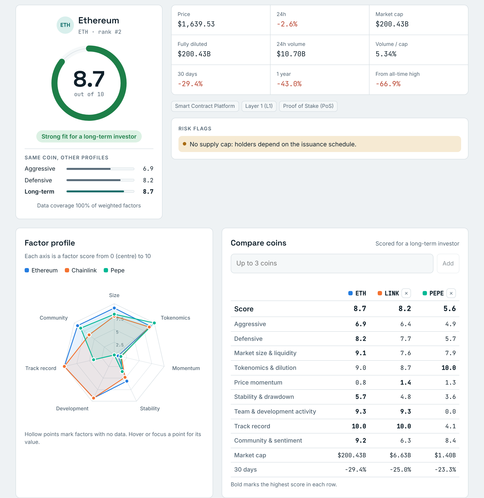

# AssetLens

**AssetLens** scores any cryptocurrency, US stock or ETF from 1 to 10 for **your** investor profile (aggressive, defensive or long-term), and gives a rule-based analyst's opinion on your whole portfolio. Every point of every score is explained: you see each factor's sub-score, its weight for your profile, and the raw numbers behind it.

The app has three sections, switched from the tabs at the top:

| Section | What it scores | Data |
|---|---|---|
| **Crypto** | Any coin listed on CoinGecko | CoinGecko market data, GitHub development activity |
| **Stocks & ETFs** | 90 large US stocks and 34 popular ETFs | SEC EDGAR financial statements, weekly prices from Alpha Vantage |
| **Portfolio** | Stocks, ETFs and crypto held together | All of the above |

**Live demo:** https://angelito10-png.github.io/assetlens/



> This is a portfolio project and an analysis aid, not financial advice.

## What it does

1. You pick a coin (any of the thousands listed on CoinGecko) and an investor profile.
2. The app loads live market data from CoinGecko, then finds the project's main GitHub repository and loads its commit, contributor and star counts.
3. Seven factors are scored from 0 to 10 with fixed, documented thresholds.
4. Your profile decides how much each factor counts. The weighted average becomes a 1 to 10 score with a verdict (strong fit, good fit, mixed, weak fit, poor fit).
5. You get risk flags, recommendations for your profile, and the same coin's score under the other two profiles.
6. **Adjust weights** with sliders and watch the score recompute live, or start from any profile and tune it.
7. A **radar chart** shows the coin's shape across the seven factors at a glance.
8. **Compare** up to three coins side by side: overlaid radar shapes plus a table of every score, with the best value in each row marked.
9. **English and Greek.** Every text, including factor explanations, risk flags and recommendations, comes from a translation dictionary (`src/i18n.js`). The language follows your browser and can be switched at any time.
10. **Light and dark themes**, following your system setting or chosen by hand.
11. **Profile quiz.** Not sure which profile fits you? Five questions (reaction to a 40% drop, time horizon, goal, preferred kind of coin, how you manage a position) pick one, show how your answers split, and apply it in one click.
12. **Watchlist.** Star any coin to keep it in a list saved in your browser. The star at the top right opens the list in a side panel, which shows each coin's price, daily change and score for your current profile (or custom weights), best first, and refreshes all prices with a single API call.
13. **Categories menu.** Layer 1, Layer 2, DeFi, RWA, AI, Meme, Gaming, DePIN, Oracles, Privacy and Stablecoins. Each opens the top 50 coins of that CoinGecko category with price, daily change and a quick score for your profile (market data only, one API call per category), sortable by market cap or score. Click a coin for its full analysis.
14. **Latest news** for the selected coin: recent headlines from CryptoPanic and major crypto news sites, refreshed every 3 hours.

Results are shareable: the URL carries the coin, profile, custom weights and compared coins, for example `?coin=ethereum&profile=defensive&vs=solana,chainlink&lang=el`.

## Side columns

On wide screens every page has two side columns. On smaller screens they move below the main content.

- **Market overview (left):** S&P 500 and Nasdaq 100, followed through SPY and QQQ with the visitor's own price key (index prices can't be republished for free), gold (through GLD, same key), Bitcoin, the total crypto market cap with Bitcoin's share (CoinGecko), and the crypto Fear & Greed index (alternative.me). Each source loads on its own, so one failure doesn't blank the rest.
- **At a glance (right, stays in view):** the current asset's score, verdict and top three risks, plus up to three assets from the same sector, ETF category or crypto category that score higher for the chosen profile. On the portfolio page it shows the portfolio score, its main problems and the first fixes.

## Crypto scoring model

| Factor | What it measures | Aggressive | Defensive | Long-term |
|---|---|---:|---:|---:|
| Market size & liquidity | Market-cap rank, daily volume relative to market cap | 10% | 25% | 15% |
| Tokenomics & dilution | Share of supply circulating, fully diluted value vs market cap, supply cap | 15% | 15% | 25% |
| Price momentum | 7-day, 30-day and 1-year price change | 30% | 5% | 5% |
| Stability & drawdown | Distance from all-time high, daily range, weekly swing | 5% | 25% | 10% |
| Team & development | GitHub commits (4 weeks), contributors, stars, last push | 20% | 10% | 25% |
| Track record | Years since launch | 5% | 20% | 15% |
| Community & sentiment | CoinGecko watchlists, positive sentiment votes | 15% | 0% | 5% |

Design choices worth calling out:

- **Missing data is skipped, not punished.** If a source fails or doesn't report a value, that factor is dropped and its weight is shared among the rest. The page shows a data-coverage figure so you know how complete the score is.
- **Absence of code is information.** A coin that lists no public repository scores 0 on development, and its long-term score is capped at 6.
- **Profile rules.** Defensive scores are capped at 5 outside the top 100 coins.
- **Final score = 1 + 0.9 × weighted average**, so the scale runs from 1 to 10.

Limits: neither source says who runs a project, so GitHub activity stands in for team credibility. The app cannot detect anonymous teams, past scandals, missing audits or token unlock dates.

## Stocks & ETFs

The same tools as the crypto section (profiles, weight sliders, radar, side-by-side comparison, quiz, watchlist, sector menu, news, Greek and English), on a different set of factors.

**Stocks** are scored from the companies' own filings with the SEC (trailing twelve months where the quarterly reports allow it), plus prices when available:

| Factor | What it measures | Aggressive | Defensive | Long-term |
|---|---|---:|---:|---:|
| Valuation | P/E, price/sales, free-cash-flow yield (P/B for banks and REITs) | 10% | 20% | 20% |
| Growth | Revenue growth (1 and 3 years), EPS growth | 30% | 5% | 25% |
| Profitability | Net and operating margin, return on equity | 15% | 20% | 25% |
| Financial health | Debt to equity, cash vs debt (equity to assets for banks) | 5% | 25% | 15% |
| Dividend | Yield and payout ratio | 0% | 15% | 5% |
| Momentum | 3, 6 and 12-month return, position vs the 40-week average | 30% | 0% | 5% |
| Risk | Volatility, drawdown, beta | 10% | 15% | 5% |

**ETFs** are scored on what matters for a fund:

| Factor | What it measures | Aggressive | Defensive | Long-term |
|---|---|---:|---:|---:|
| Cost | Expense ratio | 10% | 15% | 30% |
| Diversification | Number of holdings, weight of the top 10, sector or single-asset focus | 10% | 20% | 20% |
| Size | Assets under management | 10% | 15% | 10% |
| Performance | 1, 3 and 5-year returns | 45% | 5% | 15% |
| Risk | Volatility and drawdown | 15% | 30% | 10% |
| Income | Distribution yield | 0% | 10% | 5% |
| Track record | Years since launch | 10% | 5% | 10% |

**Commodities** (gold, silver, platinum, copper, oil, natural gas, farm goods and broad baskets) are held through commodity ETFs, because a commodity has no earnings or balance sheet to read. They get their own factors:

| Factor | What it measures | Aggressive | Defensive | Long-term |
|---|---|---:|---:|---:|
| Cost | Expense ratio | 10% | 15% | 25% |
| Structure | Physical metal in a vault (best), futures (roll costs), futures with a K-1 tax form (worst) | 10% | 20% | 20% |
| Hedge value | How well the commodity has protected against inflation and stock market falls (gold highest, natural gas lowest) | 5% | 25% | 20% |
| Trend | 1-year and 6-month return, position vs the 40-week average | 45% | 0% | 5% |
| Size & liquidity | Assets under management, daily traded value | 10% | 15% | 10% |
| Risk | Volatility and drawdown | 10% | 20% | 10% |
| Track record | Years since launch | 10% | 5% | 10% |

Commodity funds that hold futures are capped at 6 for long-term investors, because rolling contracts erodes returns over years (oil and gas funds have lost most of their value this way despite rising spot prices).

Profile rules: defensive scores are capped at 5 for stocks with volatility above 45% and ETFs above 35%; long-term scores are capped at 6 for loss-making companies and for funds charging 0.5% a year or more.

### Where the data comes from, and why

- **Fundamentals: SEC EDGAR.** Public, free and official. The SEC API does not allow browser calls, so a GitHub Actions job (`scripts/fetch-markets.mjs`) reads each company's XBRL facts and recent filings at deploy time and publishes the result as `markets.json`. It handles the usual tagging differences between companies (several revenue and debt concepts, fiscal years that don't follow the calendar, share classes).
- **Prices: Alpha Vantage, with the visitor's own free key.** Free price APIs don't allow their data to be republished on a public site. So the page asks each visitor for their own free key (25 calls a day), calls Alpha Vantage from their browser, and caches the weekly series locally for 20 hours. Without a key, stocks are scored on fundamentals alone and the page says which factors are missing. The snapshot job can also publish prices (`ALPHAVANTAGE_PUBLISH=1`) if a key with publishing rights is configured.
- **ETF facts** (fee, holdings, sector split, launch year) are kept in `src/universe.js`, dated, from the issuers' fact sheets.
- **News:** RSS headlines from public finance feeds, matched by ticker or company name, plus links to the latest 10-K, 10-Q and 8-K filings on sec.gov.

## Portfolio analyst

Enter what you hold (any mix of stocks, ETFs, commodity funds and crypto, with the dollar value of each) and choose a profile. A rule-based analyst writes **what works, what doesn't and what to fix**, in order of impact. Every sentence comes from a fixed rule applied to your numbers, so the same portfolio always gets the same advice, and the rules are unit-tested.

It looks through funds into their sectors and top holdings, so owning NVDA next to QQQ counts as overlap, and a tech ETF counts toward your tech exposure.

| Limit | Aggressive | Defensive | Long-term |
|---|---:|---:|---:|
| Portfolio volatility | 32% | 13% | 20% |
| Crypto | 25% | 5% | 10% |
| Bonds or gold, at least | – | 25% | – |
| Commodities other than precious metals | 20% | 10% | 15% |
| One holding | 30% | 15% | 20% |
| One sector | 50% | 30% | 40% |

Other rules: a 3 to 15% gold position counts as a strength for defensive and long-term investors, more than 25% in gold is flagged, too few or too many positions, no broad core fund, no international exposure, two funds that hold the same thing, highly correlated holdings, fees above a cheaper equivalent in the same category, low income for a defensive investor, and holdings that score poorly for the profile.

**Portfolio score** = the value-weighted average of the holdings' scores, minus 1 point for each serious problem and 0.5 for each moderate one (at most 3). A portfolio of great companies can still be a poor fit if one of them is 60% of a defensive investor's money. Volatility uses the covariance of weekly returns when prices are available, so diversification shows up in the number.

Holdings stay in the browser and in the URL (`?h=s:AAPL:5000,e:VOO:10000,c:bitcoin:2000`), so a portfolio can be shared as a link.

## Architecture

No framework, no chart library, no build step, no backend. The radar chart is hand-built SVG. It is a static site of plain ES modules, so it deploys anywhere.

```
index.html          crypto page shell (markets.html and portfolio.html share it)
styles.css          design tokens (light and dark themes) and layout
src/engine.js       crypto scoring engine: pure functions, no DOM or network
src/markets-engine.js  stock and ETF factors, profiles and caps
src/prices.js       weekly price statistics, beta, portfolio volatility, correlation
src/analyst.js      portfolio analyst rules
src/universe.js     the stock and ETF lists, sectors, ETF facts
src/markets-api.js  snapshot loading, visitor's price key, local price cache
src/markets-app.js, src/portfolio-app.js   the stocks & ETFs and portfolio pages
src/ui.js           shared page parts: theme, language, dial, radar
src/sidebar.js      side columns: market overview and the "at a glance" card
src/i18n-markets.js English and Greek text for the two new sections
src/watchlist.js    watchlist stored in localStorage: snapshots, price refresh, pure functions
src/categories.js   category menu (CoinGecko category ids) and ranking with the quick score
src/quiz.js         investor-profile quiz: questions and scoring, pure functions
src/i18n.js         English and Greek dictionaries, t() lookup
src/api.js          CoinGecko and GitHub clients with sessionStorage caching and rate-limit handling
scripts/            build steps that run in GitHub Actions: news headlines and the SEC snapshot
src/app.js          UI: coin search, weight sliders, SVG radar chart, comparison, URL state
tests/              unit tests for the engine, a regression test on real captured API data, and translation checks
```

- **Separation of concerns:** the scoring engine is pure and fully unit-tested; the UI only renders what it returns.
- **Rate limits:** CoinGecko's free API allows a few calls per minute, and GitHub allows 60 anonymous calls per hour. Responses are cached per session, and each analysis uses one CoinGecko call and three or four GitHub calls. When a limit is hit, the app says so and keeps the rest of the score.
- **Safety:** all data is rendered with `textContent` (never `innerHTML`), and links from the APIs are only used when they start with `http(s)://`.

## Run it locally

```bash
npm test     # 60 unit tests, Node 20+
npm start    # serves the site at http://localhost:3000
```

Any static file server works, since the browser calls the public APIs directly. The Stocks & ETFs and Portfolio sections need the SEC snapshot; build it once with

```bash
SEC_USER_AGENT="your-name you@example.com" node scripts/fetch-markets.mjs markets.json
```

## Deployment

Every push to `main`, and a schedule every 3 hours, runs the tests and deploys to GitHub Pages (`.github/workflows/pages.yml`).

### News without exposing an API key

CryptoPanic needs a private API key and does not accept calls from browsers, so the page never calls it. Instead, the deploy job runs `scripts/fetch-news.mjs`, which reads the key from the `CRYPTOPANIC_TOKEN` repository secret, collects headlines and publishes only those as `news.json` next to the site. It also reads the public RSS feeds of several crypto news sites and matches headlines to coins by name or ticker, so news still works when no key is set. If every source fails, the deploy still goes ahead and the page says news is unavailable.

Note: as of November 2026 CryptoPanic's Cloudflare protection refuses requests from GitHub Actions runners (HTTP 403), so on the hosted demo the headlines come from the RSS feeds. The CryptoPanic path is kept and works from networks CryptoPanic accepts.

### SEC snapshot

The deploy job also runs `scripts/fetch-markets.mjs`. The SEC asks automated clients to identify themselves, so the job reads a user agent with a contact address from the `SEC_USER_AGENT` repository secret. If the job fails, the previous `markets.json` is kept.

## License

MIT
