# AssetLens

**Understand an investment before you make it.** AssetLens scores cryptocurrencies, US stocks, ETFs and commodity funds from 1 to 10 for *your* investor profile (aggressive, defensive or long-term), and explains every point of the score. It also checks a whole portfolio with a rule-based analyst, tests whether its own scores worked in the past, and teaches investing strategies with a calculator and a backtest.

**[Live demo](https://angelito10-png.github.io/assetlens/)** · **[75-second video](docs/media/demo.mp4)** · English and Greek · light and dark · desktop and phone

[](https://github.com/Angelito10-png/assetlens/actions/workflows/ci.yml)
[](https://github.com/Angelito10-png/assetlens/actions/workflows/pages.yml)

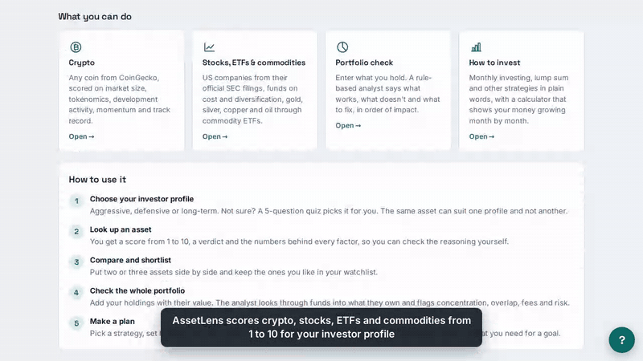

> A portfolio project and an educational analysis aid, not financial advice. Scores describe how well an asset fits a profile today; they do not predict prices.

## Screenshots

| | |
|---|---|
| 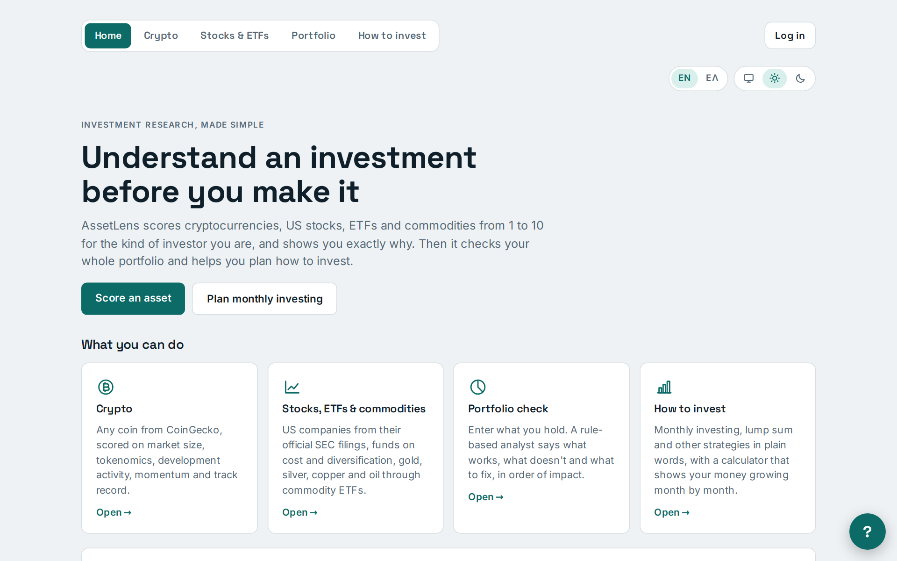 **Home**: what the app does and how to use it | 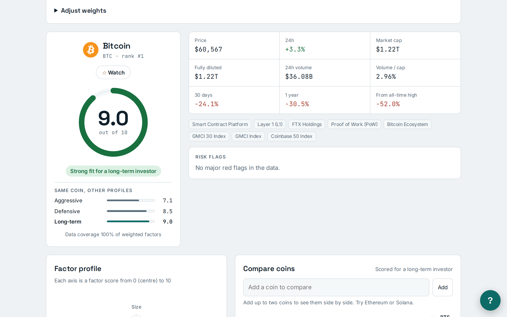 **Crypto**: a live score with its verdict, flags and advice |
| 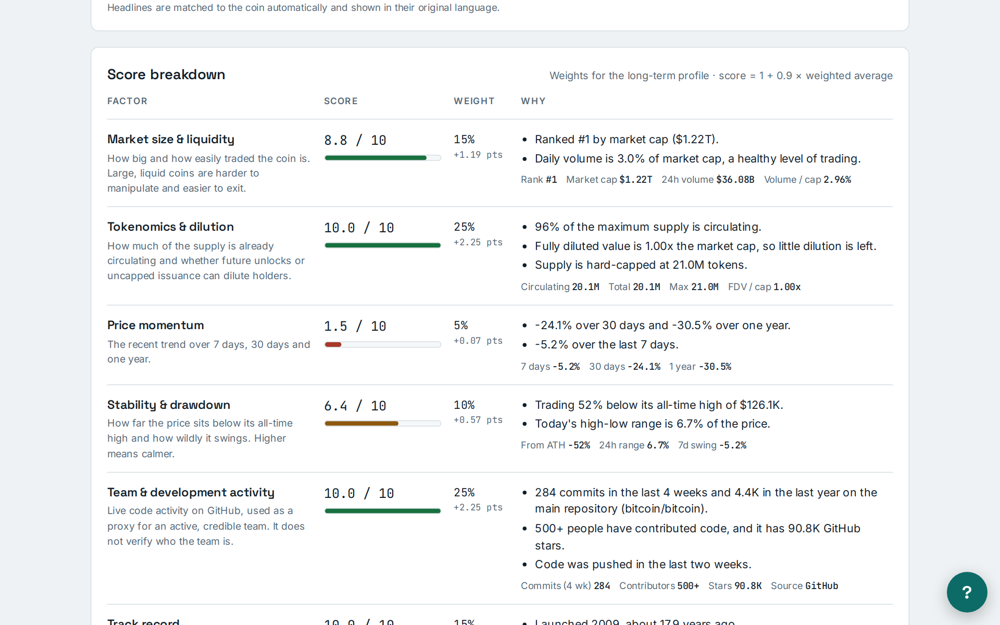 **Every factor explained**: sub-score, weight and the raw numbers | 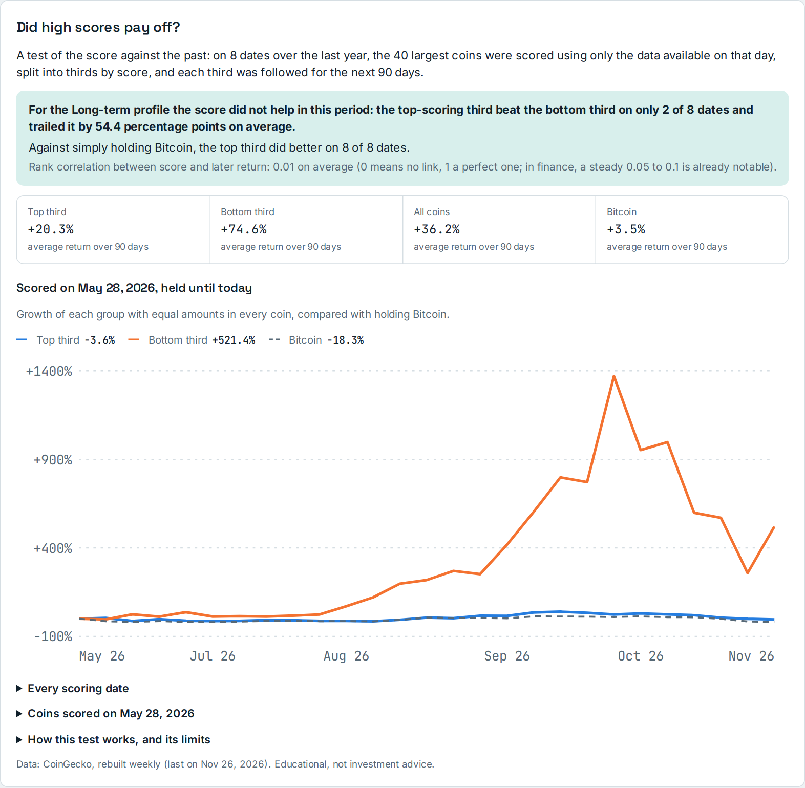 **Did high scores pay off?** The score tested on the past year |
| 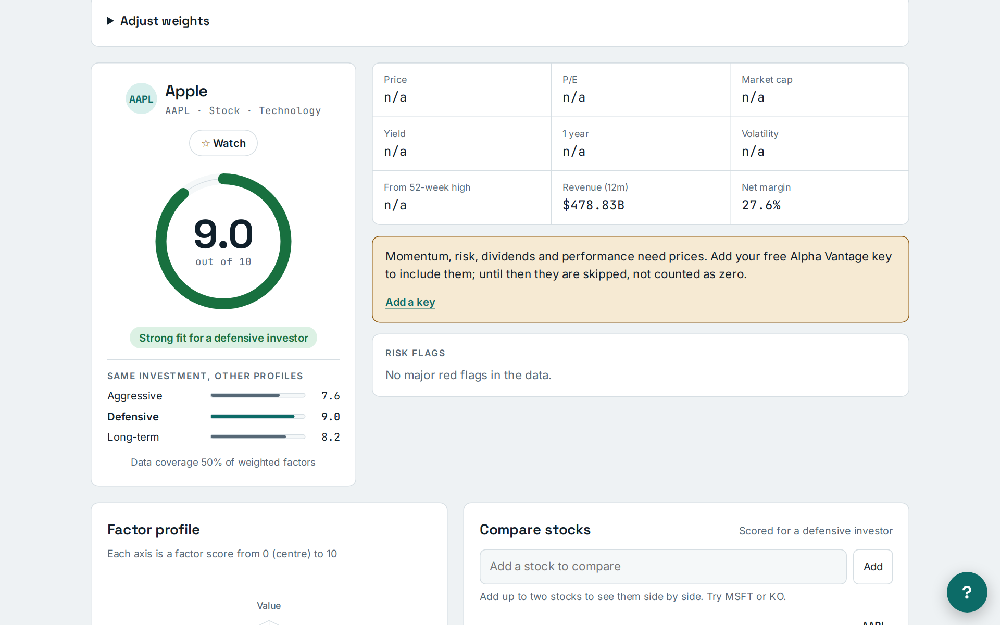 **Stocks & ETFs**: SEC filings and prices | 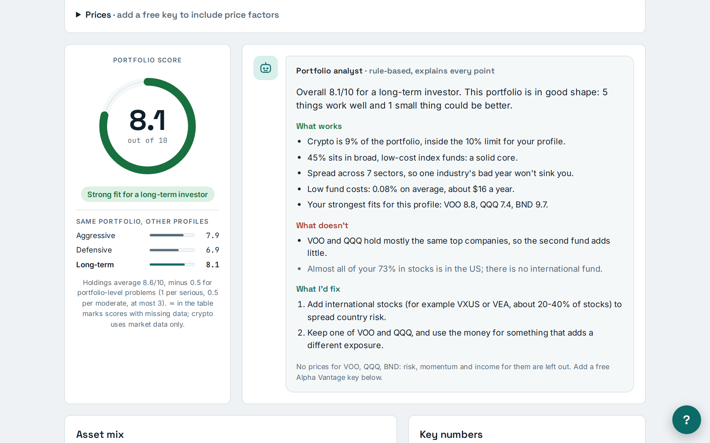 **Portfolio**: what works, what doesn't, what to fix |
| 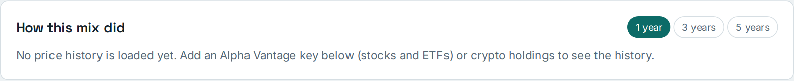 **How the mix did** against the S&P 500 | 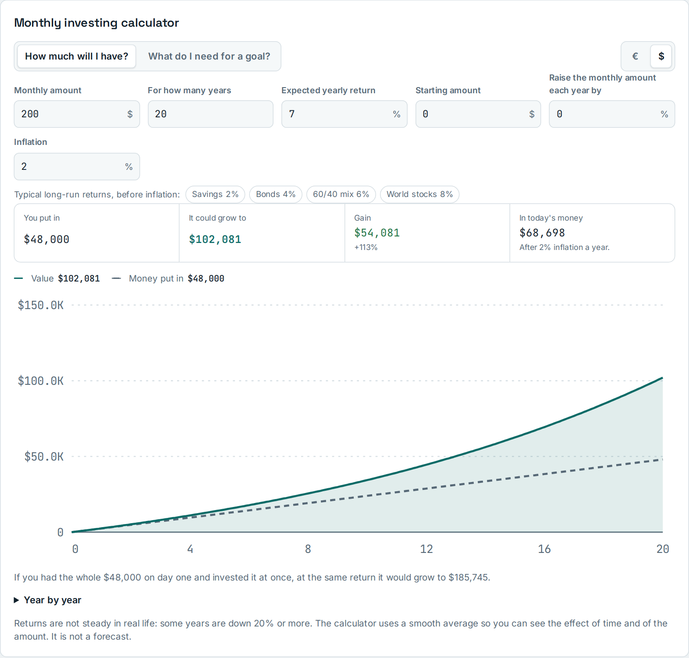 **How to invest**: calculator and backtest |
| 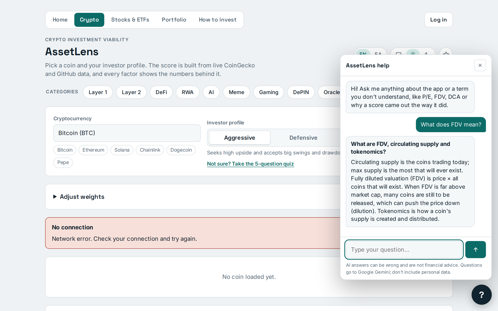 **Help assistant**: the app's own help, plus AI answers when signed in | 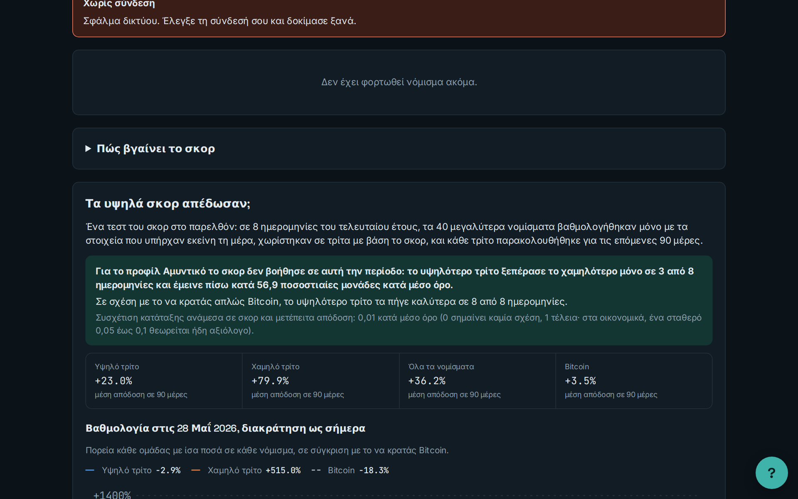 **Greek and dark mode** |

<p align="center">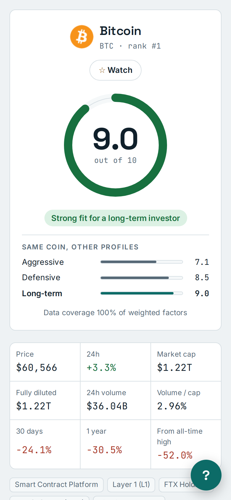</p>

Screenshots, the video and the GIF are made by a GitHub Actions workflow (`.github/workflows/media.yml`) that opens the site in a real browser with live data, so they can be refreshed in one click. A narrated version can be recorded with [docs/demo-script.md](docs/demo-script.md) (shot list, timings, narration in English and Greek).

## Highlights

- **Explainable scores.** Seven crypto factors, and separate factor sets for stocks, ETFs and commodity funds, each scored 0 to 10 with fixed, documented thresholds and weighted by profile. Missing data is skipped and shown as coverage, never silently counted as zero.
- **Three profiles, one asset.** The same coin or stock is judged differently for an aggressive, defensive or long-term investor, and you can tune the weights with sliders.
- **Honest backtest.** Coins are re-scored on past dates using only what was known then, split into thirds, and compared with Bitcoin over the next 90 days. The page states the method's limits: survivorship bias, overlapping windows and the one-year data window.
- **Portfolio analyst.** Rule-based and unit-tested. It looks through funds into their holdings, measures volatility from the covariance of weekly returns, flags concentration, overlap and fees, and charts today's mix against the S&P 500 over 1, 3 or 5 years.
- **Learn to invest.** Strategies in plain words, a monthly-investing calculator, and a backtest of monthly investing on real fund prices.
- **Help assistant.** A "?" on every page answers from the app's own bilingual help text. Signed-in users get AI answers through a Supabase Edge Function that keeps the key server-side, grounds answers in the help text and the page on screen, refuses buy or sell advice, and limits each user to a set number of questions a day.
- **Accounts.** Optional email sign-in (Supabase, row-level security) syncs the portfolio, watchlists and plans across devices.
- **Built to be shared.** Every view is a URL (`?coin=ethereum&profile=defensive&vs=solana`), works in English and Greek, and in light and dark themes.

## Architecture

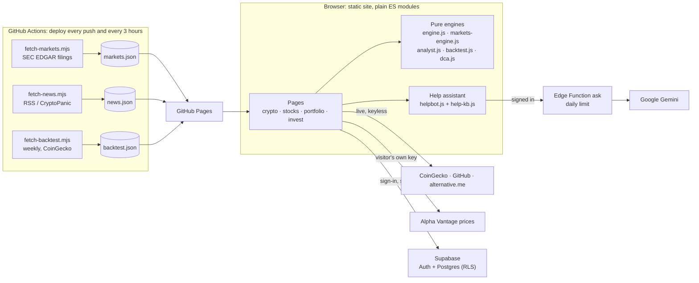

The scoring engines are pure functions with no DOM or network access, so every rule is unit-tested in Node. The pages only render what the engines return. Secrets never reach the browser: the SEC contact and the CryptoPanic key live in repository secrets used by the build, and the AI key lives in the Edge Function's secrets.

## Data sources and their limits

| Source | Used for | Access | Limits, and how the app handles them |
|---|---|---|---|
| CoinGecko | Coin prices, market data, categories, one year of history | Free public API, from the browser and the build | A few calls a minute: responses are cached per session, the backtest is built weekly in the deploy job, and only one year of history is available without a key |
| GitHub | Development activity of crypto projects | Free public API | 60 calls an hour without a key: cached; the factor is skipped when the limit is hit |
| SEC EDGAR | Company financial statements | Free, built into `markets.json` by the deploy job | No browser access (no CORS), so it is snapshotted at build time; a few companies file under unusual tags |
| Alpha Vantage | Weekly stock and ETF prices | Visitor's own free key (25 calls a day) | Free prices can't be republished, so each visitor uses their own key; prices are cached for 20 hours |
| alternative.me | Crypto Fear & Greed index | Free | None in practice |
| RSS feeds, CryptoPanic | Headlines | Built into `news.json` | CryptoPanic blocks GitHub's servers, so the RSS feeds carry the hosted demo |
| Supabase | Accounts, sync, AI question counts | Free tier | Row-level security; the AI key stays in an Edge Function secret |
| Google Gemini | AI answers in the help assistant | Free tier, server-side only | Daily limit per user; the app falls back to its own help text |

## Tech stack

- **Front end:** HTML, CSS and plain JavaScript ES modules. No framework, no bundler, no chart library: the radar chart, line charts and score dial are hand-built SVG.
- **Build and hosting:** GitHub Actions and GitHub Pages; Node scripts for the data snapshots.
- **Back end:** Supabase (Auth, Postgres with row-level security, an Edge Function in TypeScript).
- **Quality:** 81 unit tests with Node's built-in test runner. Browser checks with Playwright, and Lighthouse reports from the media workflow ([latest results](docs/media/lighthouse.md)).
- **Accessibility:** Lighthouse accessibility 100 on every page:
  - contrast checked for both themes;
  - a skip link, visible focus and keyboard-operable controls;
  - labelled charts and dialogs;
  - reduced-motion support.
- **Performance:**
  - Self-hosted, preloaded fonts.
  - The help text and the backtest data load only when needed.
  - Space is reserved for parts that scripts fill in, so pages don't jump.
  - API responses are cached in the browser.
  - Asset URLs are stamped with the commit, so caches never mix versions.

## How to run it

```bash
git clone https://github.com/Angelito10-png/assetlens.git && cd assetlens
npm test     # 81 unit tests, Node 20+
npm start    # serves the site at http://localhost:3000
```

The crypto section and the investing guide work straight away. Two sections need extra data:

- **Stocks & ETFs and Portfolio** need the SEC snapshot. Build it once with `SEC_USER_AGENT="your-name you@example.com" node scripts/fetch-markets.mjs markets.json`.
- **The score backtest** needs `backtest.json`. Build it with `node scripts/fetch-backtest.mjs backtest.json`, which takes a few minutes.

Accounts and AI answers are optional; see [Accounts](#accounts) and [Help assistant](#help-assistant).

# In detail

## Crypto section

1. You pick a coin (any of the thousands listed on CoinGecko) and an investor profile.
2. The app loads live market data from CoinGecko, then finds the project's main GitHub repository and loads its commit, contributor and star counts.
3. Seven factors are scored from 0 to 10 with fixed, documented thresholds.
4. Your profile decides how much each factor counts. The weighted average becomes a 1 to 10 score with a verdict (strong fit, good fit, mixed, weak fit, poor fit).
5. You get risk flags, recommendations for your profile, and the same coin's score under the other two profiles.
6. **Adjust weights** with sliders and watch the score recompute live, or start from any profile and tune it.
7. A **radar chart** shows the coin's shape across the seven factors at a glance.
8. **Compare** up to three coins side by side: overlaid radar shapes plus a table of every score, with the best value in each row marked.
9. **English and Greek.** Every text, including factor explanations, risk flags and recommendations, comes from a translation dictionary (`src/i18n.js`). The language follows your browser and can be switched at any time.
10. **Light and dark themes**, following your system setting or chosen by hand.
11. **Profile quiz.** Not sure which profile fits you? Five questions (reaction to a 40% drop, time horizon, goal, preferred kind of coin, how you manage a position) pick one, show how your answers split, and apply it in one click.
12. **Watchlist.** Star any coin to keep it in a list saved in your browser. The star at the top right opens the list in a side panel, which shows each coin's price, daily change and score for your current profile (or custom weights), best first, and refreshes all prices with a single API call.
13. **Categories menu.** Layer 1, Layer 2, DeFi, RWA, AI, Meme, Gaming, DePIN, Oracles, Privacy and Stablecoins. Each opens the top 50 coins of that CoinGecko category with price, daily change and a quick score for your profile (market data only, one API call per category), sortable by market cap or score. Click a coin for its full analysis.
14. **Latest news** for the selected coin: recent headlines from CryptoPanic and major crypto news sites, refreshed every 3 hours.

Results are shareable: the URL carries the coin, profile, custom weights and compared coins, for example `?coin=ethereum&profile=defensive&vs=solana,chainlink&lang=el`.

## Side columns

On wide screens every page has two side columns. On smaller screens they move below the main content.

- **Market overview (left):** S&P 500 and Nasdaq 100, followed through SPY and QQQ with the visitor's own price key (index prices can't be republished for free), gold (through GLD, same key), Bitcoin, the total crypto market cap with Bitcoin's share (CoinGecko), and the crypto Fear & Greed index (alternative.me). Each source loads on its own, so one failure doesn't blank the rest.
- **At a glance (right, stays in view):** the current asset's score, verdict and top three risks, plus up to three assets from the same sector, ETF category or crypto category that score higher for the chosen profile. On the portfolio page it shows the portfolio score, its main problems and the first fixes.

## Crypto scoring model

| Factor | What it measures | Aggressive | Defensive | Long-term |
|---|---|---:|---:|---:|
| Market size & liquidity | Market-cap rank, daily volume relative to market cap | 10% | 25% | 15% |
| Tokenomics & dilution | Share of supply circulating, fully diluted value vs market cap, supply cap | 15% | 15% | 25% |
| Price momentum | 7-day, 30-day and 1-year price change | 30% | 5% | 5% |
| Stability & drawdown | Distance from all-time high, daily range, weekly swing | 5% | 25% | 10% |
| Team & development | GitHub commits (4 weeks), contributors, stars, last push | 20% | 10% | 25% |
| Track record | Years since launch | 5% | 20% | 15% |
| Community & sentiment | CoinGecko watchlists, positive sentiment votes | 15% | 0% | 5% |

Design choices worth calling out:

- **Missing data is skipped, not punished.** If a source fails or doesn't report a value, that factor is dropped and its weight is shared among the rest. The page shows a data-coverage figure so you know how complete the score is.
- **Absence of code is information.** A coin that lists no public repository scores 0 on development, and its long-term score is capped at 6.
- **Profile rules.** Defensive scores are capped at 5 outside the top 100 coins.
- **Final score = 1 + 0.9 × weighted average**, so the scale runs from 1 to 10.

Limits: neither source says who runs a project, so GitHub activity stands in for team credibility. The app cannot detect anonymous teams, past scandals, missing audits or token unlock dates.

### Score backtest: did high scores pay off?

The crypto page tests the score against the past. Once a week the deploy job (`scripts/fetch-backtest.mjs`) loads a year of daily prices, market caps and volumes for today's 40 largest coins (no stablecoins or wrapped tokens) from CoinGecko's free API. Then:

1. On a scoring date every 30 days, each coin is scored using **only the data known that day**. A unit test checks that changing later prices doesn't change the score.
2. The coins are split into thirds by score, and each third's equal-weight return over the next 90 days is compared with the bottom third and with holding Bitcoin.
3. The page shows the result for the chosen profile:
   - a plain-language verdict (top third beat bottom third on k of m dates);
   - the average return of each group;
   - the rank correlation between score and later return;
   - a chart of the groups scored about six months ago and held until today;
   - the table of every scoring date.

Limits, also stated on the page:

- **Factors used.** Only size, momentum and stability can be rebuilt for past dates. Tokenomics, development, maturity and community are left out.
- **Price window.** The free API gives one year of history, so the one-year change and the true all-time high aren't available.
- **Survivorship bias.** Today's largest coins exclude those that collapsed.
- **Overlapping windows.** Scoring dates are 30 days apart but each is held 90 days, so the results are not independent.

Only derived results (scores, group returns, growth curves) are published, never raw prices. Stocks and ETFs will join once their price history can be published (see below).

## Stocks & ETFs

The same tools as the crypto section (profiles, weight sliders, radar, side-by-side comparison, quiz, watchlist, sector menu, news, Greek and English), on a different set of factors.

**Stocks** are scored from the companies' own filings with the SEC (trailing twelve months where the quarterly reports allow it), plus prices when available:

| Factor | What it measures | Aggressive | Defensive | Long-term |
|---|---|---:|---:|---:|
| Valuation | P/E, price/sales, free-cash-flow yield (P/B for banks and REITs) | 10% | 20% | 20% |
| Growth | Revenue growth (1 and 3 years), EPS growth | 30% | 5% | 25% |
| Profitability | Net and operating margin, return on equity | 15% | 20% | 25% |
| Financial health | Debt to equity, cash vs debt (equity to assets for banks) | 5% | 25% | 15% |
| Dividend | Yield and payout ratio | 0% | 15% | 5% |
| Momentum | 3, 6 and 12-month return, position vs the 40-week average | 30% | 0% | 5% |
| Risk | Volatility, drawdown, beta | 10% | 15% | 5% |

**ETFs** are scored on what matters for a fund:

| Factor | What it measures | Aggressive | Defensive | Long-term |
|---|---|---:|---:|---:|
| Cost | Expense ratio | 10% | 15% | 30% |
| Diversification | Number of holdings, weight of the top 10, sector or single-asset focus | 10% | 20% | 20% |
| Size | Assets under management | 10% | 15% | 10% |
| Performance | 1, 3 and 5-year returns | 45% | 5% | 15% |
| Risk | Volatility and drawdown | 15% | 30% | 10% |
| Income | Distribution yield | 0% | 10% | 5% |
| Track record | Years since launch | 10% | 5% | 10% |

**Commodities** (gold, silver, platinum, copper, oil, natural gas, farm goods and broad baskets) are held through commodity ETFs, because a commodity has no earnings or balance sheet to read. They get their own factors:

| Factor | What it measures | Aggressive | Defensive | Long-term |
|---|---|---:|---:|---:|
| Cost | Expense ratio | 10% | 15% | 25% |
| Structure | Physical metal in a vault (best), futures (roll costs), futures with a K-1 tax form (worst) | 10% | 20% | 20% |
| Hedge value | How well the commodity has protected against inflation and stock market falls (gold highest, natural gas lowest) | 5% | 25% | 20% |
| Trend | 1-year and 6-month return, position vs the 40-week average | 45% | 0% | 5% |
| Size & liquidity | Assets under management, daily traded value | 10% | 15% | 10% |
| Risk | Volatility and drawdown | 10% | 20% | 10% |
| Track record | Years since launch | 10% | 5% | 10% |

Commodity funds that hold futures are capped at 6 for long-term investors, because rolling contracts erodes returns over years (oil and gas funds have lost most of their value this way despite rising spot prices).

Profile rules: defensive scores are capped at 5 for stocks with volatility above 45% and ETFs above 35%; long-term scores are capped at 6 for loss-making companies and for funds charging 0.5% a year or more.

### Where the data comes from, and why

- **Fundamentals: SEC EDGAR.** Public, free and official. The SEC API does not allow browser calls, so a GitHub Actions job (`scripts/fetch-markets.mjs`) reads each company's XBRL facts and recent filings at deploy time and publishes the result as `markets.json`. It handles the usual tagging differences between companies (several revenue and debt concepts, fiscal years that don't follow the calendar, share classes).
- **Prices: Alpha Vantage, with the visitor's own free key.** Free price APIs don't allow their data to be republished on a public site. So the page asks each visitor for their own free key (25 calls a day), calls Alpha Vantage from their browser, and caches the weekly series locally for 20 hours. Without a key, stocks are scored on fundamentals alone and the page says which factors are missing. The snapshot job can also publish prices (`ALPHAVANTAGE_PUBLISH=1`) if a key with publishing rights is configured.
- **ETF facts** (fee, holdings, sector split, launch year) are kept in `src/universe.js`, dated, from the issuers' fact sheets.
- **News:** RSS headlines from public finance feeds, matched by ticker or company name, plus links to the latest 10-K, 10-Q and 8-K filings on sec.gov.

## Portfolio analyst

Enter what you hold (any mix of stocks, ETFs, commodity funds and crypto, with the dollar value of each) and choose a profile. A rule-based analyst writes **what works, what doesn't and what to fix**, in order of impact. Every sentence comes from a fixed rule applied to your numbers, so the same portfolio always gets the same advice, and the rules are unit-tested.

It looks through funds into their sectors and top holdings, so owning NVDA next to QQQ counts as overlap, and a tech ETF counts toward your tech exposure.

| Limit | Aggressive | Defensive | Long-term |
|---|---:|---:|---:|
| Portfolio volatility | 32% | 13% | 20% |
| Crypto | 25% | 5% | 10% |
| Bonds or gold, at least | – | 25% | – |
| Commodities other than precious metals | 20% | 10% | 15% |
| One holding | 30% | 15% | 20% |
| One sector | 50% | 30% | 40% |

Other rules: a 3 to 15% gold position counts as a strength for defensive and long-term investors, more than 25% in gold is flagged, too few or too many positions, no broad core fund, no international exposure, two funds that hold the same thing, highly correlated holdings, fees above a cheaper equivalent in the same category, low income for a defensive investor, and holdings that score poorly for the profile.

**Portfolio score** = the value-weighted average of the holdings' scores, minus 1 point for each serious problem and 0.5 for each moderate one (at most 3). A portfolio of great companies can still be a poor fit if one of them is 60% of a defensive investor's money. Volatility uses the covariance of weekly returns when prices are available, so diversification shows up in the number.

**How this mix did.** Under the report, a chart shows today's mix bought 1, 3 or 5 years ago and held without rebalancing (adjusted prices, so dividends are reinvested), against the S&P 500 (SPY). It also gives the return, the return a year, the largest drop and the yearly volatility. Holdings without prices are left out and listed. A holding with shorter history moves the start date, which is said on the page: crypto has one year of free data.

Holdings stay in the browser (and in your account when you log in) and in the URL (`?h=s:AAPL:5000,e:VOO:10000,c:bitcoin:2000`), so a portfolio can be shared as a link.

## How to invest

A plain-language guide to seven ways of investing (monthly investing / dollar-cost averaging, lump sum, value averaging, buy and hold with index funds, core and satellite, rebalancing, reinvesting income), each with what it is good for and what to watch out for, and a short "which one fits you".

- **Calculator.** Monthly amount, years, expected yearly return (with typical long-run returns as presets), starting amount, a yearly raise of the monthly amount, and inflation. It shows money put in, final value, gain, the value in today's money, the same total invested at once for comparison, a chart with a hover read-out, and a year-by-year table. In goal mode it works backwards: the monthly amount needed for a target, and the yearly return needed with the current monthly amount.
- **Backtest on real history.** Pick a fund or stock and see what investing a fixed amount on the first trading week of every month would have done over up to 20 years, using adjusted prices (dividends reinvested). It compares the result with investing the same total on day one and shows the worst moment of the plan, when it was furthest below the money put in.

The maths is in `src/dca.js` (pure functions, unit-tested against the closed-form annuity formula).

## Accounts

Log in and sign up use [Supabase](https://supabase.com) (free tier): email and password authentication plus one Postgres table, `user_data`, with a JSON column holding the synced keys. Row-level security lets each signed-in user read and write only their own row, so the project URL and the anon (publishable) key can safely be in the browser.

- **What is synced:** portfolio, both watchlists, investor profile, investing plan, language and theme. The Alpha Vantage key never leaves the browser.
- **How:** the app keeps using `localStorage`. On log in, what the account holds wins and anything it lacks is filled from the browser (so a first sign-up uploads what you already entered); after that, every change to a synced key is saved within a couple of seconds.
- **Also:** password reset by email, log out, and "delete my saved data".
- **Without settings** (a fork, or local development) the account button says data is kept in the browser and nothing else changes.

### Switching accounts on

1. Create a free project at supabase.com.
2. In **SQL Editor**, run [`docs/supabase.sql`](docs/supabase.sql). It creates the table, grants signed-in users access to it (newer projects no longer do this automatically) and adds the row-level security policies. It is safe to run again.
3. In **Authentication → URL Configuration**, set the Site URL to the address of the site (for the demo, `https://angelito10-png.github.io/assetlens/`) and add the same address to the redirect URLs.
4. Optionally, in **Authentication → Sign In / Providers → Email**, turn off "Confirm email" so new accounts can log in at once (the free plan sends only a few emails an hour).
5. In **Project Settings → API**, copy the project URL and the anon (or publishable) key, and add them to the GitHub repository as **variables** (Settings → Secrets and variables → Actions → Variables) named `SUPABASE_URL` and `SUPABASE_ANON_KEY`. The deploy job writes them into `src/config.js`.

## Help assistant

A "?" button on every page opens a small chat for questions about the app and its terms ("what is FDV?", "why is this score 5.2?", "is it better to invest all at once?").

- **Always works:** the app carries its own help text (`src/help-kb.js`, about 30 checked explanations in English and Greek). Without AI, the best matches are shown as the answer, with related questions to tap.
- **With AI (signed-in users):** the question goes to a Supabase Edge Function (`supabase/functions/ask/index.ts`) together with what is on screen and the matching help entries, so answers are about AssetLens and the numbers the user is looking at. The function checks the user's session, counts questions in the database (15 a day each by default) and calls Google Gemini (free tier, Flash-Lite). The AI key is a function secret and never reaches the browser.
- **Guard rails:** the model is told to answer briefly in the user's language, to stay on the app and investing terms, and never to tell anyone to buy, sell or hold. Answers are rendered as text (bold, lists) without HTML.

### Switching the AI on

1. Get a free API key at [Google AI Studio](https://aistudio.google.com/apikey) (no card needed).
2. Run [`docs/supabase.sql`](docs/supabase.sql) again in the SQL Editor. It adds the `ai_usage` table and the `bump_ai_usage()` function that counts questions.
3. In Supabase, **Edge Functions → Deploy a new function → Via Editor**, name it `ask`, replace the template with [`supabase/functions/ask/index.ts`](supabase/functions/ask/index.ts) and click **Deploy function**.
4. **Edge Functions → Secrets:** add `GEMINI_API_KEY` with the key. Optional: `ASK_DAILY_LIMIT` (default 15), `GEMINI_MODEL` (default `gemini-flash-lite-latest`), `ALLOWED_ORIGINS` (default the GitHub Pages site and localhost).

Note: on Google's free tier, prompts may be used to improve Google's products, so the chat tells users not to type personal data.

## Code layout

No framework, no chart library, no build step, and no server of its own (accounts use Supabase's hosted API). The radar chart is hand-built SVG. It is a static site of plain ES modules, so it deploys anywhere.

```
index.html          home page
crypto.html, markets.html, portfolio.html, invest.html   the four sections (old ?coin= links on / are forwarded to crypto.html)
src/home.js, src/invest-app.js   the home page and the investing guide, calculator and backtest
src/backtest.js     score backtest (point-in-time crypto scores, thirds, rank correlation) and portfolio history: pure functions
src/score-backtest-app.js, src/linechart.js, src/i18n-backtest.js   the backtest section, the shared line chart, their English and Greek text
src/dca.js          monthly plan, goal, required return and backtest maths: pure functions
src/account.js, src/config.js   accounts: Supabase sign-in, sync of saved data, settings filled at deploy
src/i18n-site.js    English and Greek text for the home page, guide, accounts and help assistant
src/helpbot.js, src/help-kb.js   help assistant: chat window, the app's help text and its search
supabase/functions/ask/index.ts   Edge Function behind the AI answers (Gemini, per-user daily limit)
fonts/              self-hosted variable fonts (Inter, Space Grotesk, JetBrains Mono; SIL Open Font License)
styles.css          design tokens (light and dark themes) and layout
src/engine.js       crypto scoring engine: pure functions, no DOM or network
src/markets-engine.js  stock and ETF factors, profiles and caps
src/prices.js       weekly price statistics, beta, portfolio volatility, correlation
src/analyst.js      portfolio analyst rules
src/universe.js     the stock and ETF lists, sectors, ETF facts
src/markets-api.js  snapshot loading, visitor's price key, local price cache
src/markets-app.js, src/portfolio-app.js   the stocks & ETFs and portfolio pages
src/ui.js           shared page parts: theme, language, dial, radar
src/sidebar.js      side columns: market overview and the "at a glance" card
src/i18n-markets.js English and Greek text for the two new sections
src/watchlist.js    watchlist stored in localStorage: snapshots, price refresh, pure functions
src/categories.js   category menu (CoinGecko category ids) and ranking with the quick score
src/quiz.js         investor-profile quiz: questions and scoring, pure functions
src/i18n.js         English and Greek dictionaries, t() lookup
src/api.js          CoinGecko and GitHub clients with sessionStorage caching and rate-limit handling
scripts/            build steps that run in GitHub Actions: news headlines, the SEC snapshot and the weekly score backtest
scripts/media/      screenshots, demo video, GIF and Lighthouse table (run by .github/workflows/media.yml)
src/app.js          UI: coin search, weight sliders, SVG radar chart, comparison, URL state
tests/              unit tests for the engine, a regression test on real captured API data, and translation checks
```

- **Separation of concerns:** the scoring engine is pure and fully unit-tested; the UI only renders what it returns.
- **Rate limits:** CoinGecko's free API allows a few calls per minute, and GitHub allows 60 anonymous calls per hour. Responses are cached per session, and each analysis uses one CoinGecko call and three or four GitHub calls. When a limit is hit, the app says so and keeps the rest of the score.
- **Safety:** all data is rendered with `textContent` (never `innerHTML`), and links from the APIs are only used when they start with `http(s)://`.

## Deployment

Every push to `main`, and a schedule every 3 hours, runs the tests and deploys to GitHub Pages (`.github/workflows/pages.yml`).

### News without exposing an API key

CryptoPanic needs a private API key and does not accept calls from browsers, so the page never calls it. Instead, the deploy job runs `scripts/fetch-news.mjs`, which reads the key from the `CRYPTOPANIC_TOKEN` repository secret, collects headlines and publishes only those as `news.json` next to the site. It also reads the public RSS feeds of several crypto news sites and matches headlines to coins by name or ticker, so news still works when no key is set. If every source fails, the deploy still goes ahead and the page says news is unavailable.

Note: as of November 2026 CryptoPanic's Cloudflare protection refuses requests from GitHub Actions runners (HTTP 403), so on the hosted demo the headlines come from the RSS feeds. The CryptoPanic path is kept and works from networks CryptoPanic accepts.

### SEC snapshot

The deploy job also runs `scripts/fetch-markets.mjs`. The SEC asks automated clients to identify themselves, so the job reads a user agent with a contact address from the `SEC_USER_AGENT` repository secret. If the job fails, the previous `markets.json` is kept.

### Screenshots, demo video and Lighthouse

`.github/workflows/media.yml` does the following:

1. Builds the site the same way the deploy does and serves it locally.
2. Opens it in Chromium with live data (`scripts/media/capture.mjs`).
3. Saves the screenshots, records a captioned demo of about 75 seconds (`docs/media/demo.mp4`, plus `demo.gif` for this page), and runs Lighthouse on every page (`docs/media/lighthouse.md`).
4. Commits the results to the branch it ran on.

It runs on demand (Actions → "Screenshots, demo video and Lighthouse" → Run workflow) and whenever its own files change. Stock prices on the stock and portfolio screenshots need a free Alpha Vantage key saved as the repository secret `DEMO_AV_KEY`. The key is used only inside that run's throwaway browser.

## License

MIT
